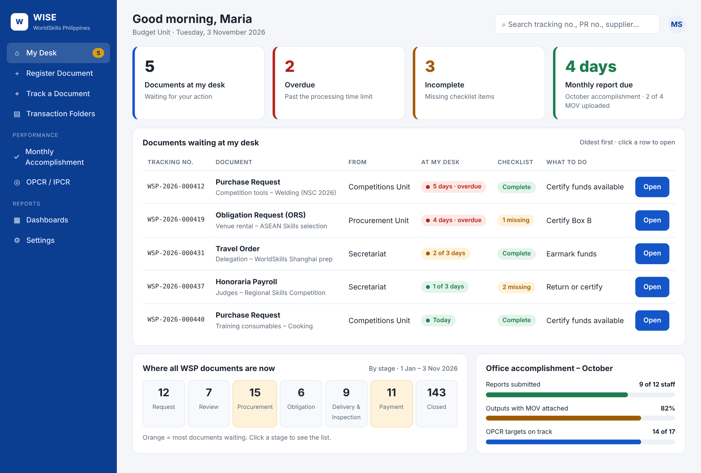
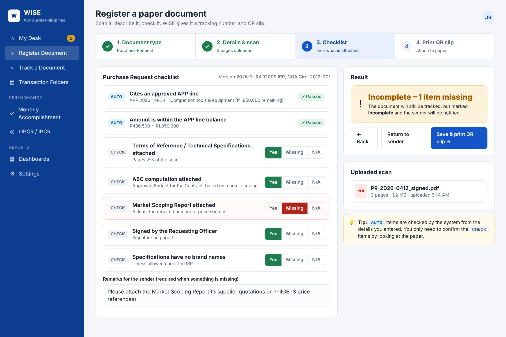
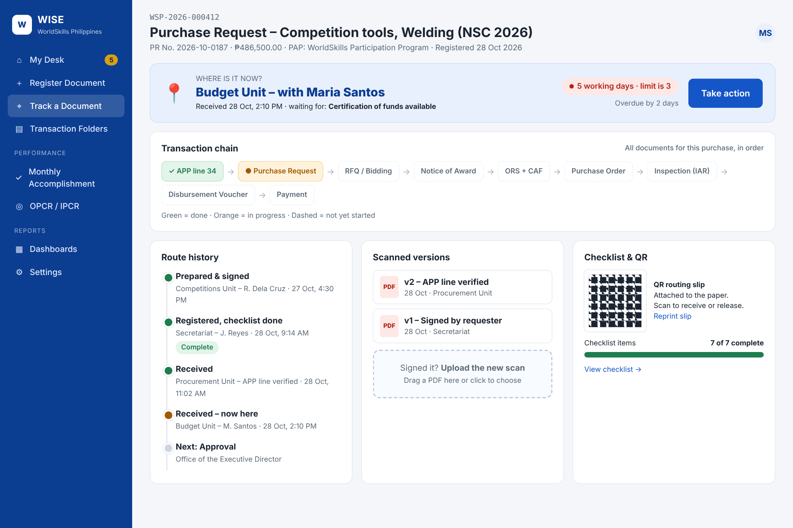
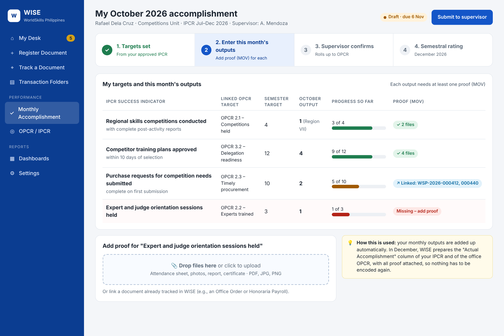
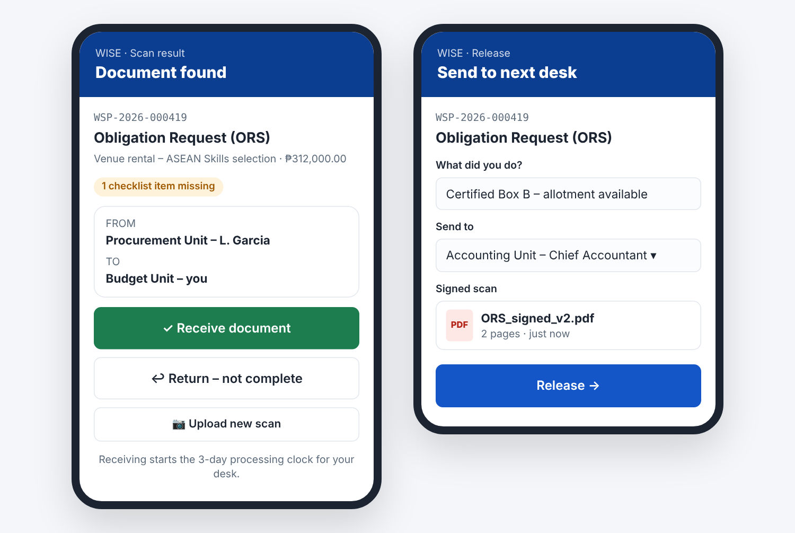

# WISE — WorldSkills Philippines Integrated Administrative System

A proposed system for running the WorldSkills Philippines (WSP) Secretariat's
planning, procurement, budget, disbursement, performance-monitoring and
audit-closure work as one document flow you can trace from end to end. Every document passes a
checklist set by its **document type** before it can move forward.

| File | Contents |
|---|---|
| [`docs/01-system-proposal.md`](docs/01-system-proposal.md) | Main proposal: the corrected process model, modules, roles, controls, architecture, roadmap |
| [`docs/02-document-checklists.md`](docs/02-document-checklists.md) | Checklists for each document type (required fields, attachments, prior documents, signatories) |
| [`docs/03-legal-basis-and-corrections.md`](docs/03-legal-basis-and-corrections.md) | Legal and regulatory references, and where the reference flow was corrected |
| [`docs/04-development-phases.md`](docs/04-development-phases.md) | Development phases (Phase 1: document tracking, scanned uploads, monitoring) |
| [`docs/05-item-request-flow-review.md`](docs/05-item-request-flow-review.md) | Review and corrected version of the item request → stock/procurement → property → payment flowchart |
| [`config/document-types.yaml`](config/document-types.yaml) | Machine-readable checklist and routing definitions for the workflow engine |

> **Status:** draft proposal for validation by the WSP Secretariat, TESDA
> Planning, Budget, Accounting, BAC Secretariat, Legal, and Internal Audit.
> Peso thresholds, signatories, and delegated approval limits are deliberately
> left as configuration. Take them from the current IRR of RA 12009, GPPB
> issuances, and the TESDA Delegation of Authority in force.

## Phase 1 user interface (prototype)

Clickable mockup: [`prototype/index.html`](prototype/index.html). Open it with `#dashboard`, `#register`, `#track`, `#monthly`, or `#mobile` at the end of the address.

| My Desk (home) | Register a paper document |
|---|---|
|  |  |
| **Track a document** | **Monthly accomplishment** |
|  |  |

**Proposed-change screens** (item request flow review): `#request`, `#procure`, `#failed`, `#cse`, `#iar`, `#dv`. See [`docs/05-item-request-flow-review.md`](docs/05-item-request-flow-review.md#4-user-interface-for-the-proposed-changes).

**Mobile QR receive / release**

