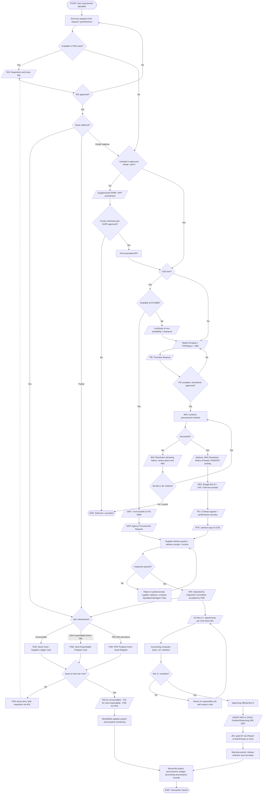
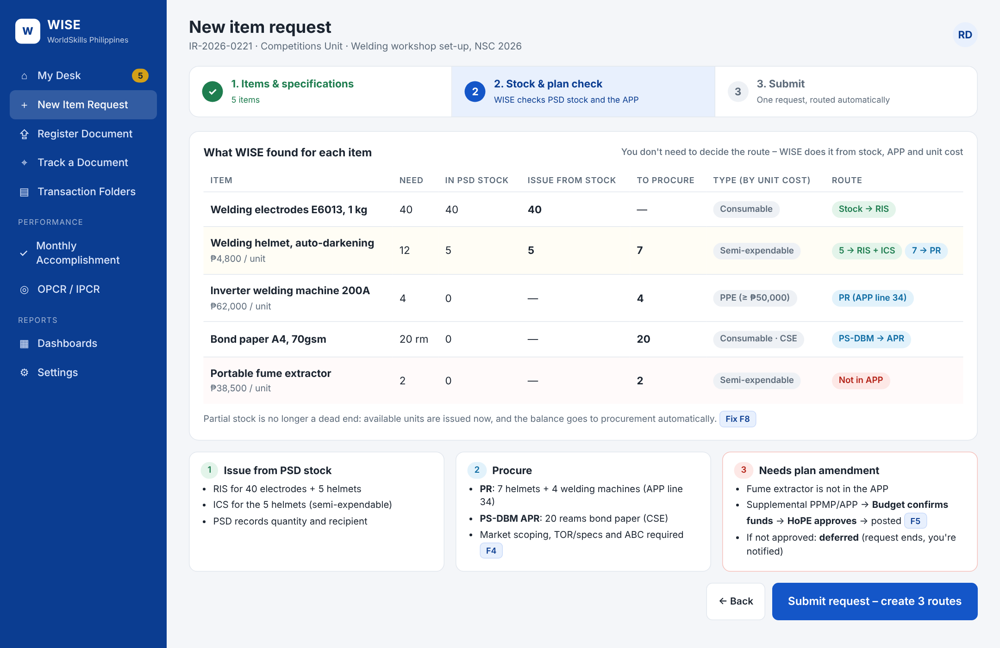
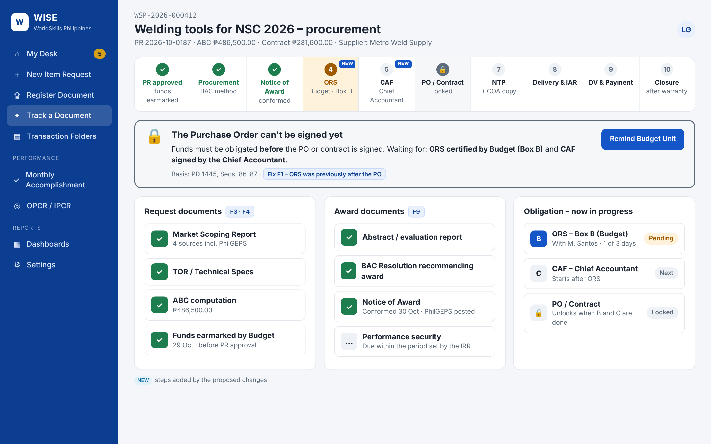
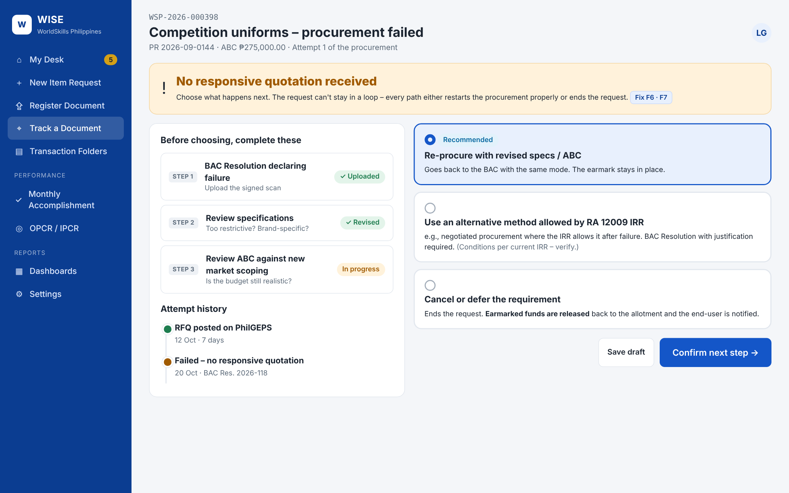
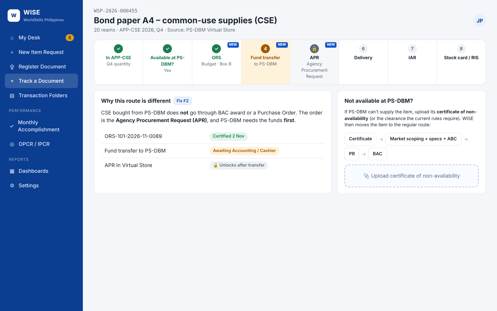
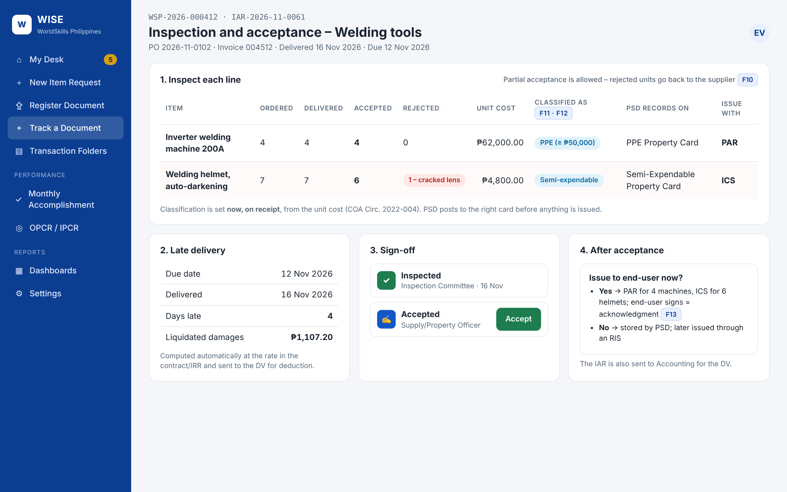
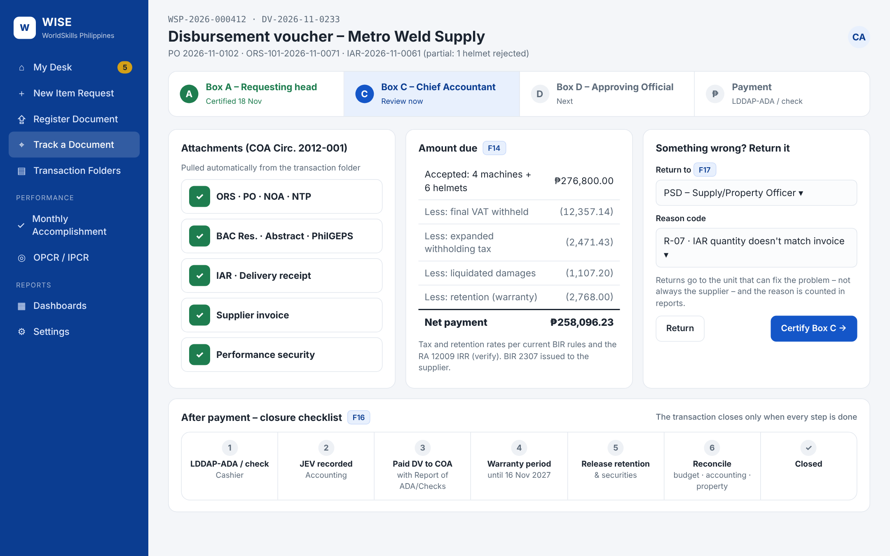

# Review: Item Request → Stock / Procurement → Property → Payment Flow

This reviews the WorldSkills item-request flowchart (5 swimlanes: Stock Issuance,
Procurement Planning, Procurement & Delivery, Property Issuance & Accountability,
Accounting/Payment/Closure). It is checked against RA 12009 and its IRR, PD 1445,
the GAM for NGAs, COA Circ. 2012-001, COA Circ. 2022-004, and PS-DBM rules.

**Overall:** the structure is sound. It checks PSD stock first, uses the APP/CSE
decision, has a CSE non-availability clearance branch, classifies property into
consumable / semi-expendable / PPE, sends stored items back through a later RIS, and ends with reconciliation.
These are all correct and should be kept. Most of the problems are about **order**, especially
the obligation timing, plus a few loops that never end and some missing documents.

## 1. Findings

### Must fix: these conflict with the rules

| # | Where | What the flowchart shows | Problem | Correction |
|---|---|---|---|---|
| F1 | Lane 3 | Award / PO / Contract → **then** Budget Unit ORS | PD 1445 Secs. 86–87: no contract may be entered into without an appropriation and a certificate of funds availability. The obligation must come **before** the PO/contract is perfected. | Award (NOA) → **ORS (Budget, Box B) + CAF (Chief Accountant)** → PO/Contract signed → NTP. |
| F2 | Lane 2 → 3 | "Authorized CSE source available? Yes" goes straight to **Award / PO / Contract** | PS-DBM does not issue a PO-type award. The agency submits an **Agency Procurement Request (APR)** through the Virtual Store, and the funds must be **obligated and transferred/deposited first**. | CSE branch: **ORS → fund transfer to PS-DBM → APR → delivery → IAR**. No BAC award is needed. |
| F3 | Lane 2 | PR "complete, aligned and approved?" | There is no **fund availability / earmark** check by Budget. With no earmark, the same allotment can be committed twice. | Add "Budget certifies funds available (earmark)" before PR approval. |
| F4 | Lane 2 | Attachments: TOR/Specs, Cost Estimate | RA 12009 requires **market scoping**, and the **ABC** must be based on it. | Attachments: TOR/Technical Specs, **Market Scoping Report**, **ABC computation**. |
| F5 | Lane 2 | "Not in PPMP/APP → Supplemental PPMP/APP amendment → Amendment approved?" | An APP amendment needs **funds** (allotment or approved realignment) and approval by the **HoPE**, then posting. A "No" currently loops back to the amendment forever. | Amendment: Budget confirms funds → HoPE approves → posted. "No" → **requirement deferred/cancelled** (an end point), or re-planned for the next FY. |
| F6 | Lane 3 | PR approved enters at "Successful Procurement?" before "Conduct applicable procurement method" | The decision comes before the activity it decides on. | PR approved → **Procurement Unit/BAC conducts the procurement method** → Successful? |
| F7 | Lane 3 | "Successful? No → Failed procurement / reprocessing" loops without limit | Under RA 12009 IRR, a failure is **declared by a BAC resolution**. Specs/ABC are then reviewed and the item is re-bid or moved to an allowed alternative method. The loop also needs an exit. | Failure declared (BAC Resolution) → review specs/ABC → re-bid **or** alternative method per IRR → **or** cancel requirement (end). |
| F8 | Lane 1 | "RIS approved and stock available? No" → back to RIS | This loop never ends. It also mixes two different decisions: *not approved* and *out of stock*. | Split them: **RIS not approved** → return to end-user. **Stock insufficient** → issue what is available and send the **balance to procurement** (the "No" branch of "Available in PSD stock?"). |

### Should fix: missing documents or steps

| # | Where | Gap | Add |
|---|---|---|---|
| F9 | Lane 3 | Award documents are not itemized | **Abstract / evaluation report, BAC Resolution, Notice of Award, PhilGEPS posting**, performance security (where required), **NTP**, and a contract copy sent to COA (COA Circ. 2009-001). |
| F10 | Lane 3 | Inspection fail → "Supplier correction/replacement" | Record **rejection** in the IAR and compute **liquidated damages** if delivery is late. Allow **partial acceptance** (partial IAR). |
| F11 | Lane 3 → 4 | Classification happens only when the item is **issued** | Under the GAM the item is classified **on receipt**, when PSD records it on the correct card: **Stock Card / Supplies Ledger Card** (consumables), **Semi-Expendable Property Card**, or **PPE Property Card**. The issuance document (RIS / ICS / PAR) then follows the same classification. |
| F12 | Lane 4 | Thresholds not shown | **PPE ≥ ₱50,000 → PAR.** **Semi-expendable < ₱50,000 → ICS** (low/high-value sub-classes per COA/GAM rules, *verify*). **Consumables → RIS.** (COA Circ. 2022-004) |
| F13 | Lane 4 | "PSD releases item, WorldSkills acknowledges receipt" comes before classification | Acknowledgment **is** the RIS/ICS/PAR signature, so put classification first. Then the accountable officer signs the matching document. |
| F14 | Lane 5 | Accounting review has no deductions | **Withholding taxes** (BIR 2307 issued), **liquidated damages**, and **retention money** (warranty) are deducted at DV processing. |
| F15 | Lane 5 | DV roles are not shown | **Box A** (head of requesting unit) → **Box C** (Chief Accountant: complete, funds available) → **Box D** (approving official) → payment. |
| F16 | Lane 5 | Payment → END | After payment: **JEV**, paid DVs and the **Report of ADA/Checks Issued** submitted to COA, the **warranty period** runs, the **retention/warranty security is released**, *then* reconciliation and closure. |
| F17 | Lane 5 | "Return documents for correction" goes to supplier billing | Returns should go to whoever caused the gap (end-user for Box A attachments, PSD for the IAR, supplier for the invoice). Record a **reason code** so WISE can report it. |

### Nice to have

* **Lane colour/role labels:** each box should name the responsible unit (End-user, PSD, Budget, Accounting, BAC/Procurement Unit, Cashier, HoPE). Some do now and some don't.
* **Document shapes:** use the document shape (parallelogram) for every official form (RIS, PR, APR, ORS, NOA, PO, NTP, IAR, ICS/PAR, DV, LDDAP-ADA) so each one maps to a WISE document type and checklist.
* **End points:** add end points for "Cancelled/Deferred" and "Issued from stock (no payment)" so every path ends.

## 2. Corrected flow

A rendered copy is in [`screenshots/item-request-flow-corrected.png`](screenshots/item-request-flow-corrected.png).

## 3. How this maps into WISE

| Flow step | WISE document type (`config/document-types.yaml`) | Phase |
|---|---|---|
| RIS | `RIS` (to add), `PAR_ICS` | 1 (tracked), 3 (created in system) |
| Supplemental PPMP/APP | `PPMP`, `APP` (type: supplemental) | 1 / 2 |
| APR to PS-DBM | `APR` (to add) | 1 / 3 |
| Market scoping, TOR, PR | `MSR`, `TOR`, `PR` | 1 / 3 |
| Abstract, BAC Res, NOA | `ABSTRACT`, `BACRES`, `NOA` | 1 / 3 |
| ORS + CAF → PO → NTP | `ORS`, `CAF`, `PO` (gate G5) | 1 / 3 |
| IAR → property cards → RIS/ICS/PAR | `IAR`, `PAR_ICS` (gate G11) | 1 / 3 |
| DV → LDDAP-ADA | `DV` (gates G7, G8, G12) | 1 / 4 |
| Retention release, reconciliation | `CLOSURE` | 1 / 5 |

## 4. User interface for the proposed changes

Prototype: [`../prototype/index.html`](../prototype/index.html). Add `#request`, `#procure`, `#failed`, `#cse`, `#iar`, or `#dv` to the end of the address. Blue "F" tags on each screen point to the findings above.

| Screen | Shows fixes |
|---|---|
|  **New item request – stock & plan check** | F4, F5, F8: WISE splits one request into stock issue, procurement (PR or PS-DBM APR), and plan amendment |
|  **Procurement tracker** | F1, F3, F4, F9: ORS + CAF before PO, with the PO locked until both are certified |
|  **Failed procurement** | F6, F7: BAC resolution, spec/ABC review, then re-procure / alternative method / cancel |
|  **CSE / PS-DBM route** | F2: ORS → fund transfer → APR, plus the non-availability branch |
|  **Inspection & acceptance** | F10–F13: partial acceptance, liquidated damages, classification on receipt |
|  **Disbursement voucher** | F14–F17: Box A/C/D, deductions, return with reason code, closure checklist |
